# AlvarezGUI

AlvarezGUI 是一个 GUI Agent 训练与评测平台：在隔离的 Android 沙箱里运行任务，用视觉语言模型（MiniCPM-V、Qwen3-VL）看截图、出动作，记录完整轨迹，再用这些轨迹做 SFT 和在线强化学习（GRPO、DAPO、Dr. GRPO、GiGPO），训练后自动评测。

下面是一次完整的推箱子轨迹，来自线上评测 `eval_38c32047…`（2026-11-23）。关卡是 `sokoban-validation` 的 validation-006，模型是候选 `sokoban-sd1-merged`，运行在 Firecracker 上，用 H800 推理，temperature 0。模型 5 步通关。

| 第 0 步 | 第 1 步 | 第 2 步 | 第 3 步 | 第 4 步 | 结束 |
|---|---|---|---|---|---|
| 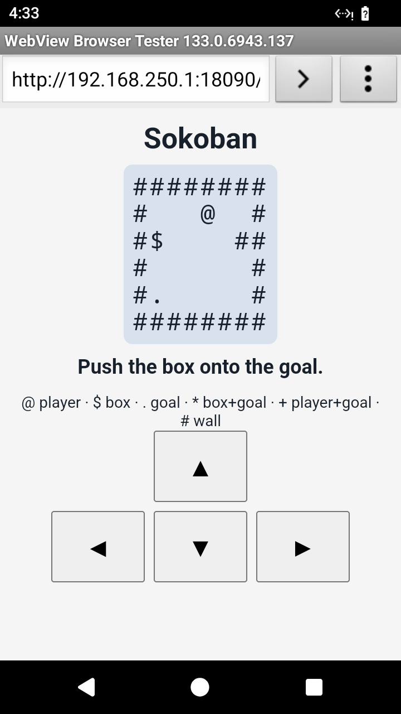 | 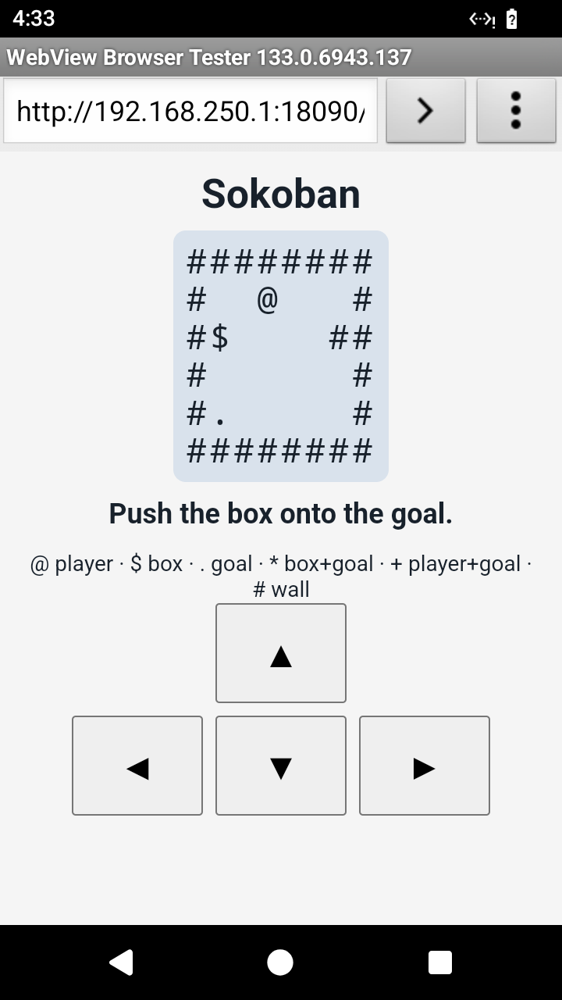 |  | 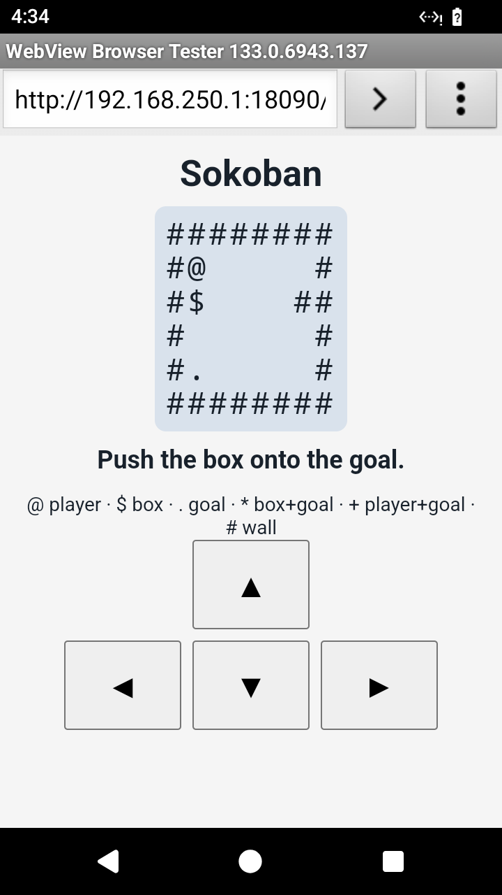 | 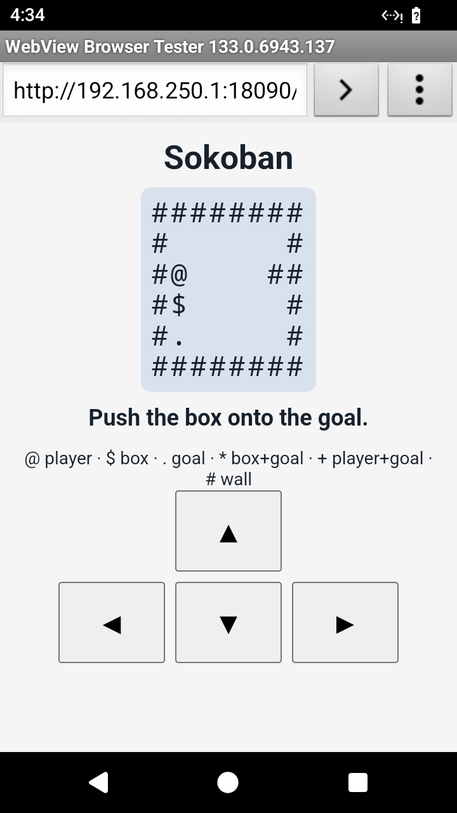 | 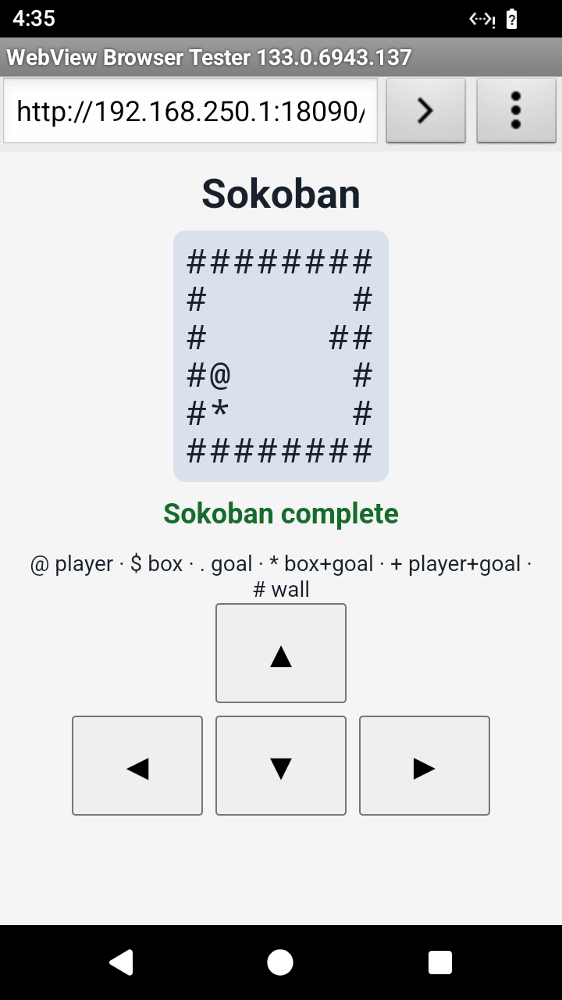 |
| 左 ◀ | 左 ◀ | 左 ◀ | 下 ▼ | 下 ▼ | Sokoban complete |

每张图都是 Android 沙箱的真实截图（720×1280），也就是模型在这一步看到的输入。模型只看截图，下表里的棋盘文字来自 fixture 的无障碍文本，只用于核对（`@` 玩家、`$` 箱子、`.` 目标、`*` 箱子在目标上、`#` 墙）。

| 步 | 动作前棋盘 | 模型原始输出 | 动作 |
|---|---|---|---|
| 0 | `#___@__#` `#$____##` `#______#` `#._____#` | `{"type":"tap","x":176,"y":980}` | 左 |
| 1 | `#__@___#` `#$____##` `#______#` `#._____#` | `{"type":"tap","x":176,"y":980}` | 左 |
| 2 | `#_@____#` `#$____##` `#______#` `#._____#` | `{"type":"tap","x":176,"y":980}` | 左 |
| 3 | `#@_____#` `#$____##` `#______#` `#._____#` | `{"type":"tap","x":360,"y":980}` | 下（推箱子） |
| 4 | `#______#` `#@____##` `#$_____#` `#._____#` | `{"type":"tap","x":360,"y":980}` | 下（推到目标） |

- [整体架构](#整体架构)
- [功能](#功能)
- [快速开始](#快速开始)
- [使用教程](#使用教程)
- [策略优化算法](#策略优化算法)
- [Firecracker 优化](#firecracker-优化)
- [Firecracker 与 Docker 对比](#firecracker-与-docker-对比)
- [其他优化](#其他优化)
- [已知限制](#已知限制)
- [相关文档](#相关文档)

## 整体架构

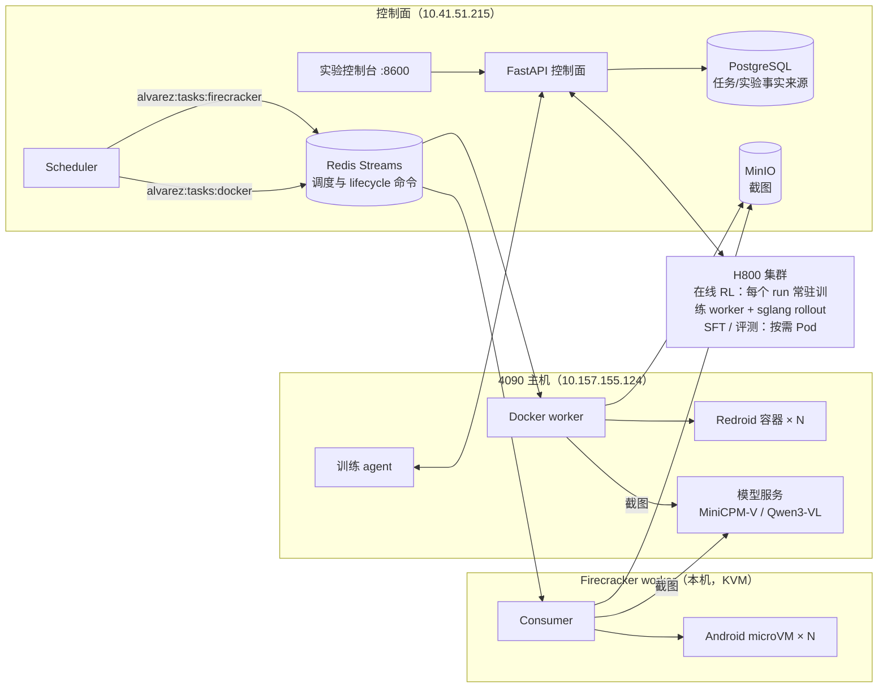

一个 episode 的执行过程：

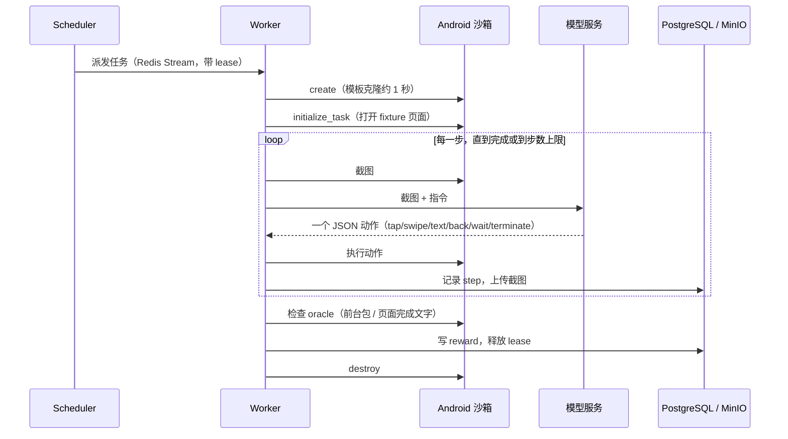

## 功能

| 模块 | 说明 |
|---|---|
| 任务与调度 | 幂等创建、查询、取消任务；PostgreSQL 持久化 task/episode/step/lease；Redis consumer group 按 backend 分流；lease 超期回收；每个节点的并发上限在控制台调，约 10 秒生效 |
| Android runtime | **Firecracker**（默认）：microVM、模板快照克隆、pause/resume、snapshot/restore。**Docker**：Redroid 容器，pause/resume，无 snapshot。episode 记录实际使用的 backend，不静默切换 |
| 任务 | Settings（检查前台包）、商城（检查 `Order complete`）、推箱子（检查 `Sokoban complete`）；推箱子题目集 `sokoban-train`（48 关）、`sokoban-validation`、`sokoban-test`（各 8 关） |
| 模型服务 | MiniCPM-V-4.7-1B、Qwen3-VL-8B-Instruct；要求输出单个 JSON 动作，格式错误返回 422；load/unload；LoRA 合并成完整权重；上报每次生成的采样熵 |
| SFT | 全参数或 LoRA（rank 16、alpha 32）、视觉 merger、双视图（完整截图 + 棋盘裁剪）、micro-batch、预处理缓存、每 epoch 打乱；H800 上按 epoch 断点续训 |
| 在线强化学习 | GRPO、DAPO、Dr. GRPO、GiGPO 共用同一套在线 rollout：每轮用上一轮策略在真实沙箱里采样，按算法计算每一步的 advantage 和 loss 权重，PPO-clip 更新；4090 或 H800 训练；H800 上每个 run 常驻一个训练 worker 和一个 sglang rollout 服务，每轮热更新权重，pod 挂了由 livenessProbe 原地重启或 launcher 重建；运行错误用同一 seed 重试最多 3 次；支持 LoRA、micro-batch 和预处理缓存。见[策略优化算法](#策略优化算法) |
| 评测 | 选模型（可多选）、runtime、推理资源（4090 常驻，或 H800 每个模型一个按需 Pod，哪个模型先就绪就先跑；MiniCPM-V 和 Qwen3-VL 都走 sglang）、单题或题目集，逐题记录成功、步数和输出格式 |
| 模型与数据管理 | 模型 / LoRA / checkpoint 三类分开管理，每个实验一个正式模型；离线轨迹数据集注册；截图存 MinIO，每日按引用 GC |

## 快速开始

依赖：Python 3.12、[uv](https://docs.astral.sh/uv/)、Docker Compose。跑 Firecracker 还需要宿主机有 `/dev/kvm`、root、`dm_snapshot` 模块和 `iptables`；跑 Docker backend 需要宿主机内核支持 Binder 和 ashmem。

```bash
# 1. 配置（密码等只放在未提交的 .env）
cp .env.example .env

# 2. 基础服务：PostgreSQL :15432、Redis :16379、MinIO :19000
docker compose up -d

# 3. 按顺序执行 migrations/001_*.sql … 013_*.sql（已有环境只执行新的）

# 4. Python 环境与服务
uv sync
.venv/bin/python -m alvarezgui.server
```

浏览器打开 `http://<主机>:8600/`，用 `.env` 里的 `CONSOLE_PASSWORD` 登录。

常用配置：

| 变量 | 作用 |
|---|---|
| `ALVAREZ_SERVER_MODE` | `all`（默认，控制面 + worker）、`control_plane`、`worker` |
| `RUNTIME_BACKEND` | 本 worker 消费的 backend：`firecracker` 或 `docker` |
| `ALVAREZ_SCHEDULER_BACKENDS` | 控制面调度哪些 backend，如 `firecracker,docker` |
| `MODEL_BACKEND` / `MODEL_SERVICE_URL` | `http` 指向真实模型服务；`fake_policy` 只用于测试 |
| `FIRECRACKER_TEMPLATE_ENABLED` | 默认 `true`：有模板就克隆启动，没有就冷启动 |
| `SANDBOX_CAPACITY` | 节点默认并发，控制台可覆盖 |

Firecracker 首次使用前先制作模板（约 2.5 分钟，worker 运行时也可以做，下一个 sandbox 自动用上）：

```bash
.venv/bin/python scripts/build_firecracker_template.py --env-file var/platform.env
```

多节点部署时，控制面用 `ALVAREZ_SERVER_MODE=control_plane`，每个 worker 用 `ALVAREZ_SERVER_MODE=worker`，配一个 backend 和唯一的 `NODE_ID`，共享同一套 PostgreSQL、Redis 和 MinIO。

## 使用教程

控制台有五个栏目：资源、数据管理、训练、评测、轨迹，另有一页内置教程。

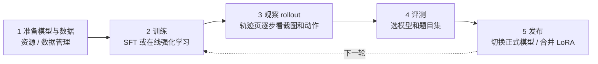

### 1. 准备模型与数据

- **资源**页：查看各节点心跳、并发上限、运行中的 sandbox；模型分"模型""LoRA""Checkpoint"三栏。LoRA 可以一键合并成完整权重（`POST /api/v1/model-versions/{v}/merge`）。
- **数据管理**页：查看离线轨迹数据集和题目集。SFT 数据来自 BFS 求解器给出的最短路径，并在真实 Android 上逐步核对过棋盘和 reward。

### 2. 新建训练

在**训练**页展开"新建训练"，或在已有实验上点"复用配置"：

| 字段 | 说明 |
|---|---|
| 算法 | `sft`，或在线策略算法 `grpo`、`dapo`、`dr_grpo`、`gigpo`（区别见[策略优化算法](#策略优化算法)） |
| 基础模型 | 必须与算法兼容，不兼容时创建时就会被拒绝 |
| 训练资源 | `4090`（一次只跑一个实验）或 `h800`（每个实验一个 Pod，可并行） |
| SFT 专用 | 数据集、merger、双视图、输出格式、打乱 |
| 在线算法专用 | `train_set`、`tasks_per_round`（1–16）、group 大小、轮数（1–100）、采样 temperature、`clip_epsilon`、runtime；DAPO 另有 `clip_epsilon_high`（默认 0.28） |
| 通用 | LoRA / 全参数、学习率、epoch、梯度累积、micro-batch、预处理缓存、梯度检查点、seed |
| `eval_set` | 训练成功后自动在这个题目集上评测 |
| `checkpoint_every` | 每 N 轮 / N 个 epoch 保留一个 checkpoint |

表单的默认值是推箱子在线 RL 目前最建议的配置，来自最近几个跑通的 H800 实验（`run_a58c3b10…`、`run_39185a4e…`、`run_658aa22c…`）和 11-24 的加速实测：

| 设置 | 默认 | 依据 |
|---|---|---|
| 算法 / 资源 | Dr. GRPO / H800 | 多步任务里不按轨迹长度归一；H800 每个实验常驻 2 张卡，rollout 用 sglang |
| 题目 | `sokoban-train` 训练，`sokoban-validation` 自动评测 | 评测题训练时没见过 |
| 轮数 × 每轮题数 × group | 20 × 8 × 8 | 每轮 64 条 rollout，48 题每题约练 3.3 次（12 × 4 时每题只练 1 次，`eval_d203e261…` 里两个 RL 模型都没超过 SFT）；group 8 比 4 更容易在组内出现成功和失败 |
| 步数 / 采样 temperature | 20 / 1.0 | 训练题最优解 4–10 步；组内要有 reward 差异 |
| 微调 / 学习率 | 全参数 / 1e-6 | 1e-7 时 BF16 几乎舍掉全部更新，1e-5 曾破坏输出格式 |
| 梯度累积 / micro-batch | 16 / 1 | 每轮 4 题时约 20–30 次更新，8 题约翻倍；batch 4 只快 10%，显存接近 80 GB |
| 预处理缓存 / 梯度检查点 | 开 / 关 | 预处理时间减半；关检查点训练快约 21%，显存 30 GB |
| 自动评测 | 每题 1 次，temperature 0 | 贪心解码重复结果基本相同 |

评测表单默认在 H800 上用 `sokoban-validation`、每题 1 次、20 步、temperature 0。每个输入框下的说明写了它的作用和取值依据。

训练配置是白名单字段，路径和命令只在服务端解析，客户端不能传任意命令。

### 3. 观察 rollout 和轨迹

训练详情页有指标曲线（reward、`rollout/entropy`、`train/entropy`、grad norm 等）和 rollout 表（含重试次数）。**轨迹**页可以逐步看每一步的截图、模型原始输出和动作。

### 4. 评测

在**评测**页展开"新建评测"，选模型（checkpoint 默认折叠，最多 6 个）、runtime、推理资源和题目（单个任务或题目集，最多 48 题）。一次评测最多 2304 个 trial（模型数 × 题数 × 每题次数）。建议主评测用 `temperature=0`，结果可复现，不同模型之间可以直接比较。

### 5. API 示例

```bash
# 创建任务（幂等）
curl -X POST http://<主机>:8600/api/v1/tasks -H 'Content-Type: application/json' -d '{...}'
curl http://<主机>:8600/api/v1/tasks/<task_id>

# 训练与评测
curl http://<主机>:8600/api/v1/training/runs/<run_id>/metrics
curl -X POST http://<主机>:8600/api/v1/evaluations -d '{...}'
```

完整路由见 `src/alvarezgui/app.py`。

## 策略优化算法

平台实现了 4 种在线策略优化算法。它们共用同一套流程：每轮从题目集抽题，每题采样 group 大小那么多条 rollout，用 PPO-clip 更新，都没有 KL 项。区别只在两处：每一步（一张截图对应一个动作）的 **advantage** 怎么算，以及每一步在 loss 里的**权重**。实现在 `training_agent.step_advantages`，训练器（`minicpm_training.train`）按每步的 `advantage` 和 `loss_weight` 计算 loss。

每种算法其实是一组组件的预设（`training_agent.ALGORITHM_PRESETS`），见下面的[算法组件](#算法组件)。不改组件时，各算法的行为和下文描述一致。

4 种算法都会跳过 advantage 为 0 的步骤：不下载截图，也不做前向。组内 reward 全相同时，GRPO、DAPO、Dr. GRPO 这一组每一步的 advantage 都是 0，整组被跳过；一轮里所有组都被跳过时，这一轮不更新模型。GiGPO 不一定整组跳过：组内都通关时，经过同一个状态的步骤如果后续步数不同，折扣回报也不同，步骤级 advantage 就不为 0。

把一条 rollout 看成论文里的一条回答，把其中每一步看成一个 token，各算法就能直接对应到这个平台上。

### 公式对比

记组内第 i 条 rollout 的最终 reward 为 R_i（推箱子通关为 1，否则为 0），步数为 |o_i|，组大小为 G，每步的重要性比为 r_{i,t}。

| 算法 | 每步 advantage | 每步 loss 权重 | clip 范围 | 额外机制 |
|---|---|---|---|---|
| **GRPO** | (R_i − mean R) / std R | 1 / (G · \|o_i\|)，每条 rollout 总权重相同；G 只数参与训练的 rollout | [1−ε, 1+ε] | 无 |
| **DAPO** | (R_i − mean R) / std R | 1 / Σ\|o_i\|，所有步骤一视同仁 | [1−ε, 1+ε_high]，默认 ε=0.2、ε_high=0.28 | 截断过滤：到 `max_steps` 的 rollout 不参与 loss，但仍计入组均值。论文的动态采样会补采到满 batch，这里没有实现 |
| **Dr. GRPO** | R_i − mean R（不除 std） | 1 / (G · `max_steps`)，用常数代替 \|o_i\| | [1−ε, 1+ε] | 无 |
| **GiGPO** | A_E(i) + ω · A_S(i, t)，ω=1 | 1 / Σ\|o_i\| | [1−ε, 1+ε] | 步骤级优势 A_S：同一组里画面相同的步骤（anchor state）比较折扣回报 γ^(T−t)·R_i，γ=0.95 |

- 训练器把一轮里所有步骤的权重缩放到平均为 1，各步之间的相对权重不变。这样不同算法在同样的学习率下，每次参数更新的幅度相近。
- GiGPO 的 A_E 和 A_S 都不除 std（论文里的 F_norm = 1）。anchor state 按动作前页面的无障碍文本判断，推箱子里这段文本包含整个棋盘。不用截图哈希是因为状态栏时钟会变，同一个棋盘的截图哈希也会不同。只出现一次的状态没有可比的对象，A_S 为 0。
- 4 种算法都用 `clip_epsilon` 作为下界。上界默认：DAPO 为 0.28，其余同 `clip_epsilon`（对称）；任何算法都可以用 `clip_epsilon_high` 单独设置上界。

### 算法组件

训练配置里的下列字段都可以单独设置，留空（`null`）就用所选算法的预设。控制台训练表单在"高级：算法组件"里，默认折叠、全部留空。

| 字段 | 取值 | GRPO | DAPO | Dr. GRPO | GiGPO |
|---|---|---|---|---|---|
| `advantage_std`：优势除以组内 std | `true` / `false` | 是 | 是 | 否 | 否 |
| `drop_zero_variance_groups`：舍弃 reward 全相同的组 | `true` / `false` | 否 | 是 | 否 | 否 |
| `clip_epsilon_high`：clip 上界 1 + 这个值 | 0–1 | 同 `clip_epsilon` | 0.28 | 同 `clip_epsilon` | 同 `clip_epsilon` |
| `overlong`：到 `max_steps` 的 rollout | `fail` / `mask` / `penalty` | 当作失败 | 屏蔽 | 当作失败 | 当作失败 |
| `overlong_penalty`：`penalty` 时的 reward | −1–0，默认 −0.1 | – | – | – | – |
| `loss_normalization`：每步权重的分母 | `per_rollout` / `batch_steps` / `constant` | 每条轨迹步数 \|o_i\| | 整批总步数 Σ\|o_i\| | 常数 | 整批总步数 |
| `loss_normalization_constant`：`constant` 的分母 | 1–1000，默认 `max_steps` | – | – | `max_steps` | – |
| `step_advantage_omega`：步级优势权重 ω | 0–10，0 关闭 | 0 | 0 | 0 | 1 |
| `step_advantage_gamma`：步级折扣 γ | 0–1，默认 0.95 | – | – | – | 0.95 |
| `invalid_output_reward`：无效输出轨迹的 reward | −1–0，默认 −0.2 | −0.2 | −0.2 | −0.2 | −0.2 |

- `drop_zero_variance_groups` 和"跳过 advantage 为 0 的步骤"不同：后者所有算法都会做，不影响分母；前者先把整组去掉，再算长度归一化的分母，被去掉的组不会稀释其余组的权重。
- `overlong` 为 `mask` 时，被屏蔽的 rollout 不训练，但仍计入组内基线；为 `penalty` 时，它的 reward 改成 `overlong_penalty`，再参与基线和训练。这里的"长度"是步数，不是 DAPO 论文里的 token 长度，所以没有实现论文的线性软惩罚。
- 无效输出指 JSON 不合法，或推箱子里点到 4 个按钮以外。这样的 rollout 在出错那一步结束，这一步也作为训练行，拿这条 rollout 的负 advantage。`invalid_output_reward` 只影响训练，评测的成功率和 reward 不变。
- 组件只对在线算法生效，SFT 设置这些字段会被拒绝。
- 组合示例：GRPO 加 `loss_normalization=batch_steps` 和 `clip_epsilon_high=0.28`，就是去掉截断过滤和动态采样的 DAPO；Dr. GRPO 加 `step_advantage_omega=1`，接近 GiGPO，只差长度归一化的分母。

### 各算法解决什么问题

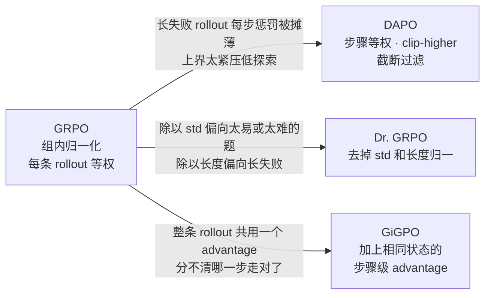

- **GRPO**（DeepSeekMath）：每条 rollout 先在内部对步骤求平均，再在组内求平均。问题在于，advantage 为负时，越长的 rollout 每一步分到的惩罚越小。推箱子里，原地乱走直到 24 步上限的 rollout，每一步只受 1/24 的惩罚。
- **DAPO**：所有步骤直接平均，长 rollout 不再被摊薄。上界放宽到 0.28，让低概率但正确的动作更容易被提高，避免熵塌缩。被步数上限截断的 rollout 可能只是"还没走完"，不当作失败惩罚。论文还有动态采样：丢掉 reward 全相同的组后继续采样，直到 batch 填满。本平台所有算法都会跳过这些组，但没有补采。
- **Dr. GRPO**：指出 GRPO 的两个偏差。除以 std 会让 reward 方差小的组（太容易或太难的题）权重偏大。除以 |o_i| 会让错误回答倾向于变长。去掉这两项后，loss 对应带均值基线的 Monte Carlo 策略梯度。
- **GiGPO**：多步 agent 任务里，整条 rollout 只有一个 reward，同一条里每一步拿到同样的 advantage。如果几条 rollout 经过了同一个棋盘状态，就能比较它们在这个状态下选了不同方向后的回报，单独奖励或惩罚这一步。这一步计算只用已有的 rollout，不需要额外采样。

### 怎么选

| 场景 | 推荐 | 原因 |
|---|---|---|
| 推箱子这类多步任务（表单默认） | Dr. GRPO | 不按 rollout 长度归一，短的成功轨迹不会被压低权重；advantage 不除 std |
| 和早期实验对比、作为基线 | GRPO | 实现最简单，最早的几个实验都是它 |
| 题目太简单或太难，很多组的 reward 全相同 | GiGPO，或换题目集 | GRPO、DAPO、Dr. GRPO 会整组跳过这些组，有效样本变少。GiGPO 在都通关的组里仍能区分步数多少。根本办法是让题目难度和模型能力匹配 |
| `max_steps` 设得偏小，很多 rollout 被截断 | DAPO | 截断过滤不把"没走完"当失败 |
| 失败 rollout 越来越长、模型学会拖步数 | DAPO 或 Dr. GRPO | 两者都不再按 rollout 长度摊薄惩罚 |
| 题目难度差异大，不想让 std 放大少数组 | Dr. GRPO | advantage 不除 std |
| 长 rollout、需要知道是哪一步走错 | GiGPO | 推箱子这类状态会重复出现的任务，最能发挥步骤级 advantage |
| rollout 之间几乎不会经过相同状态 | 不要用 GiGPO | A_S 几乎全为 0，退化成不除 std 的 GRPO |

**实现与论文的差异**：

- 都没有 KL 项（β = 0）。DAPO 和 Dr. GRPO 原文就去掉了 KL；GRPO 和 GiGPO 原文有 KL，这里省掉了。
- 没有实现 DAPO 的动态采样（补采到满 batch）。reward 全相同的组被跳过或舍弃后不补采，每轮的有效样本数可能少于 `tasks_per_round × group_size`。这一点 4 种算法都一样。
- DAPO 的 soft overlong punishment 按 token 长度线性扣分，这里没有实现；可以用 `overlong=penalty` 给到 `max_steps` 的 rollout 一个固定的负 reward。
- 每轮的样本训练 `epochs` 遍，每 `gradient_accumulation` 个样本做一次 optimizer step（默认 1，即每个样本一次）。论文是把一个 batch 切成 mini-batch 更新，两者的更新次数和每次的样本数不同。
- 4 种算法都还没有在真实在线实验里跑过对比，上表的推荐依据是论文结论和这个任务的特点，不是本平台的实测结果。11-23 的 GiGPO（`run_39185a4e…`）和 Dr. GRPO（`run_a58c3b10…`）在 48 道训练题上都没有超过 SFT 基础模型（`eval_d203e261…`：SFT 69/192，Dr. GRPO 62/192，GiGPO 43/192），当时是 12 轮 × 每轮 4 题，每题只练了 1 次。

参考：[DeepSeekMath（GRPO）](https://arxiv.org/abs/2402.03300)、[DAPO](https://arxiv.org/abs/2503.14476)、[Dr. GRPO](https://arxiv.org/abs/2503.20783)、[GiGPO](https://arxiv.org/abs/2505.10978)。

## Firecracker 优化

Firecracker 是默认 runtime。下面的优化按上线顺序排列，数字都来自本机（AMD + KVM，`/home` 为机械盘）上的真实测量。

### 优化前后

| 指标 | 优化前 | 优化后 |
|---|---|---|
| 单个 sandbox 就绪 | 冷启动 19–27 秒 | 模板克隆 0.72–0.92 秒 |
| 2 个并发启动 | 88–129 秒（整盘复制 rootfs） | 克隆 1 秒内 |
| 16 个并发启动 | 写满 `/home`，30/32 rollout 出错 | 克隆 1.81 秒全部就绪 |
| 每个 sandbox 磁盘 | 复制约 4.3 GB rootfs | COW 文件，空闲时不到 0.1 MB |
| 每个 sandbox 内存 | 2 GB | 就绪时 PSS 约 180 MB，做完任务 375–815 MB |
| 16 个 sandbox 占内存 | 约 32 GB | 约 1.9 GB（MemAvailable 减少量） |
| snapshot→restore 就绪 | 100–111 秒或失败 | 0.47–0.6 秒 |
| 8 题评测，任务开始 | 4.6–12.1 秒，每秒派发一个 | 5.2–6.2 秒内全部开始 |
| 推箱子每步 runtime 耗时 | 中位 7.0 秒 | 中位 2.59 秒 |
| 8 题评测总耗时 | 232 秒 | 164 秒 |

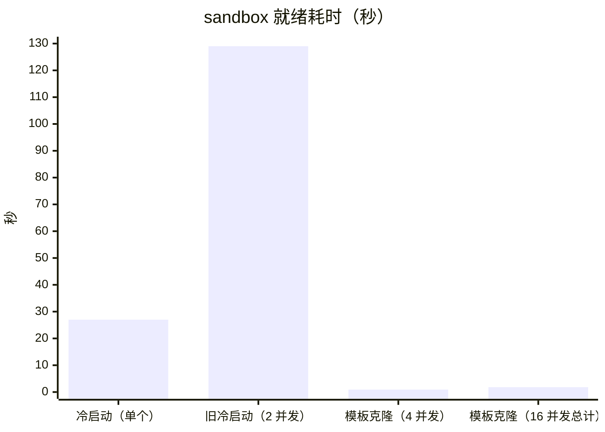

### 1. device-mapper 快照盘：不再复制 rootfs

guest 是 Debian + Docker 里跑 Redroid，根盘必须可写。原来每个 sandbox 完整复制一份约 4.3 GB 的 rootfs，16 个并发就把 `/home` 写满，同盘的 MinIO 掉线，截图上传失败。

现在所有 sandbox 共享一个只读底座镜像，每个 sandbox 只有一个稀疏 COW 文件：

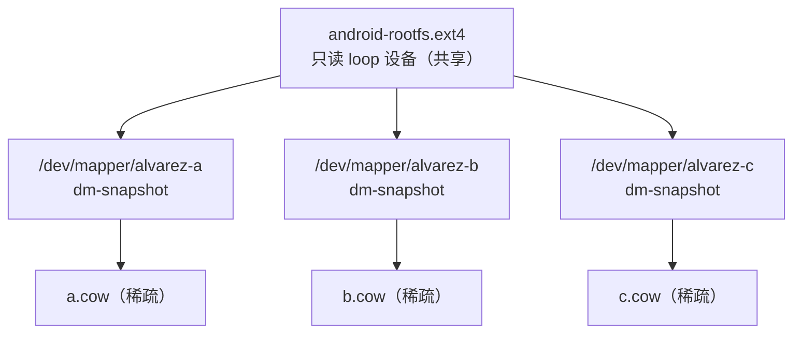

- 磁盘准备 0.06–0.15 秒，写 200 MiB 后底座镜像不变，sandbox 之间互不可见。
- COW 文件由 flock 标记属主，进程崩溃后，下一个 runtime 只清理无人持锁的残留。

### 2. 模板快照克隆：约 20 秒冷启动变成不到 1 秒

冷启动一次 Android，空闲 90 秒（等 `apexd` 等后台任务跑完）后做 Full 快照。内存文件加上同一时刻的磁盘就是模板（`memory.bin`、`snapshot.bin`、只读 `rootfs.ext4`，共 6.3 GB）。之后每个 `create()` 直接 `/snapshot/load`。

快照里写死了 guest IP、TAP 名和磁盘路径，所以要让所有 sandbox 内部看起来完全一样：

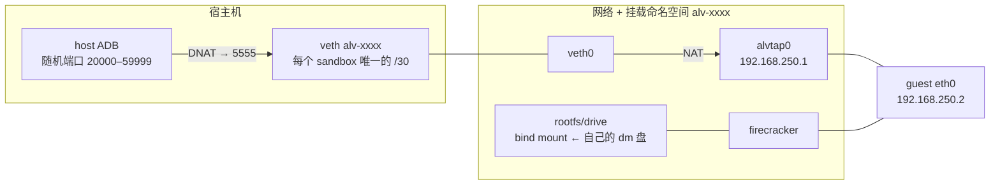

- **网络**：每个 sandbox 一个网络命名空间，里面的 TAP 名 `alvtap0` 和 guest 地址 `192.168.250.2` 都相同，通过 veth + NAT 映射到宿主机上唯一的 /30。
- **磁盘**：Firecracker 1.14 没有 `drive_overrides`。用 `ip netns exec` 启动时会得到私有挂载命名空间，在里面把自己的 dm 盘 bind mount 到固定占位路径 `rootfs/drive`，宿主机看不到。
- **内存**：`memory.bin` 按 `MAP_PRIVATE` 映射，没改过的页所有克隆共享页缓存，所以 16 个克隆只多占约 1.9 GB。
- **时钟**：克隆后 guest 时间停在模板时刻（落后 3–6 分钟），就绪后 `su 0 date @<now>` 校正，偏差 ≤ 0.5 秒。
- **ADB**：崩溃 sandbox 的 `地址:端口` 会在 host ADB 里卡成 offline 34–80 秒。每个 sandbox 换一个新的宿主机侧端口，0.58 秒就绪。
- **模板 id**：对 Firecracker 和内核的 SHA-256、rootfs 路径/大小/mtime、VM 配置取哈希。任何一项变了，旧模板自动不再使用；加载失败就冷启动一次，并在本进程内跳过这个模板。
- **页缓存预读**：模板不在页缓存时第一个克隆要 36 秒，第一个任务还会超时。worker 启动时后台顺序读一遍模板（约 47 秒），之后第一个克隆 0.64 秒就绪。

### 3. 网络隔离：guest 只能访问 fixture

命名空间的 FORWARD 链只放行到 fixture 端口（18090）的新连接，回包靠 conntrack 放行，其余从 guest 发出的流量一律 DROP。实测 guest 访问控制台端口 8600 和 PostgreSQL 主机都被拦截。

### 4. snapshot→restore 修复

- restore 前不再 `PUT /network-interfaces`：Firecracker 规定加载快照前不能配置设备，原来每次都返回 400。
- snapshot 前和 destroy 前先 `adb disconnect`，避免 host ADB 把冻结的 guest 卡在 offline 约 100 秒。
- 新快照成功后删除同 sandbox 的旧快照（每份 2.1 GB）。

restore 到就绪从 100–111 秒（或失败）降到 0.47–0.6 秒。

## Firecracker 与 Docker 对比

### 架构差异

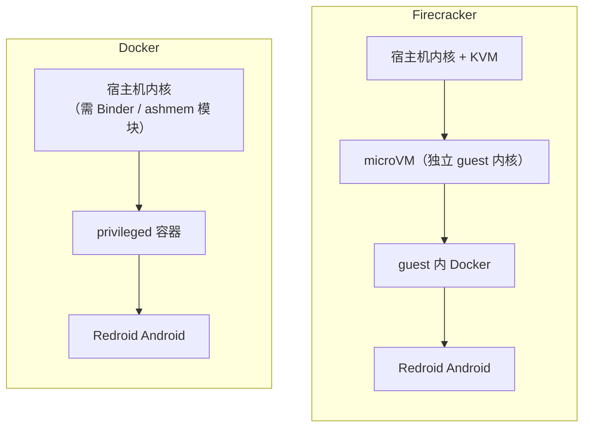

### 能力对比

| 维度 | Firecracker | Docker（Redroid） |
|---|---|---|
| 隔离 | 硬件虚拟化，独立 guest 内核；命名空间内 FORWARD 只放行 fixture 端口 | 共享宿主机内核，通常要 `--privileged`，只适合可信实验 |
| 宿主机要求 | `/dev/kvm`、root、`dm_snapshot`、iptables | 内核有 Binder、ashmem；无需 KVM |
| 启动 | 模板克隆 0.72–0.92 秒，冷启动 18.7–22.3 秒 | 冷启动约 18 秒 |
| 内存 | 克隆就绪 PSS 约 180 MB，做完任务 375–815 MB | 运行中约 1 GB |
| pause/resume | 支持 | 支持 |
| snapshot/restore | 支持，restore 0.47–0.6 秒 | 不支持 |
| 部署位置 | 本机 `10.41.51.215` | 4090 主机（无 KVM） |

### 线上评测对比

2026-11-25 两个 backend 在**相同并发**下跑同一配置的评测：`sokoban-validation` 8 题、`sokoban-sd1-merged`、H800 sglang 推理（每个模型一个 pod）、24 步上限、temperature 0。两边并发都设为 4，8 题都分两批跑，比较的是 runtime 本身，不是主机能开多少沙箱。

| 指标 | Firecracker（本机，4 并发） | Docker（4090 主机，4 并发） |
|---|---|---|
| 每步 runtime 耗时（中位，执行动作 + 截图 + UI dump） | 3.18 秒 | 2.66 秒 |
| 每步模型耗时（中位） | 0.30 秒 | 0.32 秒 |
| 任务开始到第一步（中位，不含模型） | 3.6 秒 | 3.0 秒 |
| 两批的开始时间 | 0、60、123–128 秒 | 0、56–60、127 秒 |
| 第一个任务开始到最后一个结束 | 214 秒 | 200 秒 |
| 运行错误 | 0/8 | 0/8 |
| 通关 | 2/8 | 2/8 |

几点说明：

- 同样 4 并发时，Docker 每步略快（2.66 对 3.18 秒），整次评测快 7%（200 对 214 秒）。两边在不同主机上，这部分差异也包含 CPU 和磁盘的不同；Firecracker 的 guest 是 2 vCPU 的 microVM，Docker 是限制 2 核的容器。
- Firecracker 的优势不在单步速度，而在启动、隔离和并发：模板快照克隆约 1 秒就绪（Docker Redroid 冷启动约 18 秒，见上方能力对比表）；支持 snapshot/restore；本机可以开到 63 个（受 /24 网络池限制），Docker 主机按 14 核 ÷ 每容器 2 核最多 7 个。上表的开始时间里看不出启动差异，因为两边都先等 H800 模型 pod 就绪，沙箱在这段时间里早已准备好。
- 推理现在不是瓶颈：H800 sglang 每步约 0.3 秒，只占每步耗时的十分之一。2026-11-21 的旧对比用 4090 上串行的 HF 推理，Firecracker 8 并发、Docker 4 并发，混入了并发和推理排队的差异，已经不再使用。
- 两边截图有像素差异，成功率不能直接比较；这次两边都是 2/8。

### 怎么选

- 有 KVM 的机器、大规模 rollout、需要 snapshot/restore 或安全隔离时，用 **Firecracker**。
- 机器没有 KVM（比如 GPU 主机），或者只是本地开发，用 **Docker**。

### CRIU 为什么不适合 Redroid

CRIU 可以给普通容器做 checkpoint/restore，但不适合用来解决 Docker 模式下 Redroid 的冷启动问题：

- **Binder 无法保存**：Android 的进程间通信全靠 Binder，它的状态（节点、引用、正在进行的调用）保存在宿主机内核驱动里。据我们所知，CRIU 没有 Binder 支持，也没有找到 Redroid 或 Waydroid 用 CRIU 成功恢复的案例。ashmem 和 binderfs 挂载也是同样的问题。
- **进程数量多**：一个 Redroid 容器里有 init、zygote、system_server、surfaceflinger 等几百个进程，privileged 模式下还有大量设备和挂载，都要一起保存和恢复。ADB 的 TCP 连接也要额外处理。
- **Docker 侧支持有限**：`docker checkpoint` 仍是实验功能，需要在 dockerd 里打开 experimental 并重启 dockerd。它也不支持从同一个 checkpoint 并发恢复出多个新容器，而这正是 Firecracker 模板克隆能做到的。

Firecracker 的快照在虚拟机层面保存整台 guest 的内存和设备状态，不需要理解 guest 内部有哪些进程和内核对象，所以没有这些问题。

## 其他优化

| 优化 | 效果 |
|---|---|
| 调度批量派发：`Scheduler.run_until_idle()` 每个 tick 派发到队列空或容量满 | 评测、rollout 组的任务同一秒开始，不再每秒一个 |
| UI dump 复用：`observe` 直接用上一次 `execute` 结尾的 dump | 推箱子每步 `execute + observe` 中位 7.0 → 2.59 秒，整次评测少 29% |
| 刚启动后第一个任务的重试：等 fixture 时 dump 失败继续轮询；Docker `adb root` 被拒重试 30 秒 | Firecracker 冷启动 16 并发 48 个首任务全部成功，Docker 评测 8/8 |
| H800 SFT：真实 micro-batch、CPU 预处理缓存、关闭梯度检查点 | 吞吐是基线的 4.2 倍（3.0 样本/秒） |
| Qwen3-VL 改用 sglang（之前走 HF） | 单请求约 0.3 秒、连续批处理；确定性推理下重跑结果一致（HF 换个进程只有 91%）。torch 2.9 时代的 Conv3d 矩阵乘法补丁（19.8 秒 → 5 毫秒）在 torch 2.14+ 下已不需要（Conv3d 0.7–1.8 毫秒），已删除 |
| H800 rollout 改用 sglang（连续批处理） | 每轮 rollout（32 条轨迹）789–1355 秒 → 91–114 秒 |
| H800 在线 RL 按 run 常驻 pod：训练 worker 常驻、sglang 每轮热更新权重、4090 拷贝改后台 | 每轮固定开销约 11.8 → 1–2 分钟（热更新约 0.5 分钟，训练进程内加载和保存约 0.7 分钟）；第 9 轮规模（约 440 行）一轮约 23 → 约 11 分钟（`run_658aa22c…`，含下面几项训练加速） |
| H800 训练装 flash-linear-attention + causal-conv1d（线性注意力层的 kernel） | dr_grpo 训练快 35%（Triton 缓存热时 47 → 31 秒 / 32 行） |
| 在线 RL 关闭梯度检查点、预处理缓存 | 训练快 21%（显存 20 → 30 GB）；old_logprob 与训练共用预处理，预处理时间减半 |
| 策略 logprob 只对 completion 位置做 fp32 log_softmax | 每行少约 1.3 GB 显存（24.8 万词表 × 约 1300 个 prompt token） |
| GRPO logprob 按采样 temperature 计算 | T=0.7 时训推 logprob 最大差从 1.57 降到 0.20 |
| 截图直传 MinIO + 每日按引用 GC | 本地不堆积 PNG，只删 30 天以上且无引用的对象 |

## 已知限制

- worker 的 sandbox 句柄在进程内，worker 重启后不能接管丢失的 sandbox；不承诺 exactly-once。
- 克隆再做 Full 快照仍会写出全部 2 GB 内存（约 16 秒，慢在机械盘）。
- 崩溃 sandbox 留下的 ADB offline 条目会在共享 ADB 容器里累积，要重启 `alvarez-adb-host-runtime` 才清掉。
- 模板 6.3 GB，rootfs、内核、Firecracker 或 VM 配置变了要重做；旧模板手动删除，有 sandbox 在用时不能改或删。
- Docker backend 的 privileged 模式不适合多租户；Docker Desktop 只有配置说明，未在目标平台实测。
- H800 在线 RL 每个 run 常驻 2 张 H800（训练 worker 一张、sglang rollout 一张），包括空闲阶段，run 结束才释放。H800 是 best-effort 资源，集群会把常驻 pod 挪到别的节点；挪到没有镜像的节点要重新拉镜像（约 5.5 分钟），worker 和 rollout 服务会从当前轮继续。人为卡死触发 livenessProbe 重启、单轮重启超过 5 次让 run 失败，只有单测覆盖，没在集群上实测。所有 H800 Pod 用 `sglang_v0.5.23:base` 镜像，其 sglang 补丁依赖内部实现，换镜像前要重新探测。
